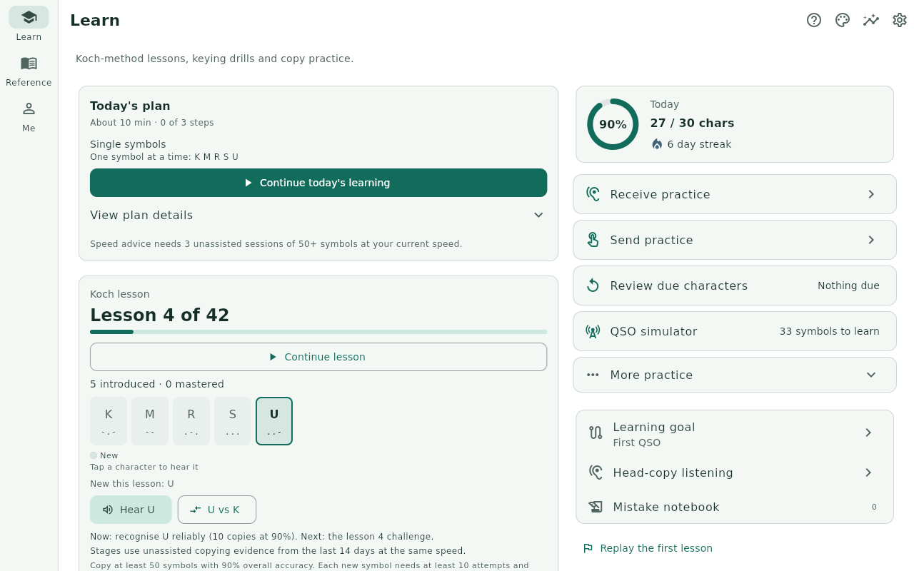

# MorseCQ

[简体中文](README.zh-CN.md)

MorseCQ is an offline Morse code trainer for Android, iOS, macOS, Linux and Windows. You can start practising without an account. For Morse chat, use [DitMesh](https://github.com/agentx-icu/ditmesh).

## Install

Choose the package for your platform and check it against the release's `SHA256SUMS`. Read the release notes for signing status and upgrade instructions. [GitHub Releases](https://github.com/agentx-icu/morsecq/releases/latest)

| Platform | Package |
| --- | --- |
| Android 7.0+ | APK for installation on a device |
| iOS 14+ | Unsigned IPA for development. Device installation requires signing. |
| macOS 13+ | Universal PKG or portable ZIP for Apple silicon and Intel |
| Linux x86_64 | DEB, RPM or portable tar.gz |
| Windows x64 | MSI or portable ZIP |

## Start learning

1. If Android shows a first-launch privacy prompt, review the policy and terms, then choose **Agree and continue** to open the app.
2. In **Learn → Start here**, play the sound and select **I heard it**. The five-step first lesson introduces short and long signals, plays a worked example and asks you to distinguish K from M. [First lesson](doc/screenshots/linux/en/first_lesson.png)
3. Try a guided exercise. Its summary shows accuracy and the number of characters heard. Select **Take the lesson challenge** when you are ready to try the current Koch lesson independently. [Receive summary](doc/screenshots/linux/en/receive_summary.png)
4. Continue with assessment, spaced review and simulated contacts (QSOs) with readiness hints. **Reference** contains the alphabet, a translator with Chinese telegraph codes, **Listen** and amateur-radio tools. **Me** contains training defaults, key setup, language and appearance.

Training supports touch and physical keyboards on phones, tablets and desktops. The app ships ten interface locales and four visual styles. Learning materials, statistics and the recorded-audio workbench support continued practice.



The Learn screen shows the next activity in your daily plan. Select a character in the Koch lesson to hear it, or choose **Continue lesson** to practise. [Screenshot gallery](doc/screenshots/README.md) · [Product design](doc/designs/product-2026-10-08/README.md)

Advanced learning adds a persistent mistake notebook, whole-word and sentence comprehension, and first-QSO, conversation and contest goal routes. The simulator includes contest and park-to-park POTA exchanges, corrections and targeted repetition. Original offline exercises follow CW Academy intermediate learning directions; assisted attempts remain separate from independent mastery. See [advanced learning](doc/architecture/ADVANCED_LEARNING.md).

Completing a daily plan records that practice. Advancing a Koch lesson requires character-level evidence from independent challenges. The [beginner trial protocol](doc/testing/BEGINNER_TRIAL.md) covers first-day and seventh-day observation without telemetry.

## Build and run

Use Flutter **3.41.9** with Dart **3.11.5**. Install the tools for your target, then run these commands from the repository root. Use a device ID from `flutter devices` in place of `macos` when testing on another supported target. See the [platform setup and packaging guide](doc/operations/BUILD_AND_DEPLOY.md).

```sh
flutter doctor -v
dart pub get --enforce-lockfile
flutter devices
cd apps/morsecq
flutter run -d macos
```

The [store and distribution matrix](doc/release/STORE_READINESS.md) records channel status, signing and device checks. On-demand branch and PR packages are for development. Tagged releases and store submissions follow the signing and approvals in that matrix. See the [F-Droid preparation guide](doc/release/F_DROID.md) for the deferred inclusion effort.

## Check changes

Run the static, package and widget checks from the repository root. The native end-to-end suite uses a connected device, a simulator or the host desktop. See the [test pyramid](doc/testing/TEST_PYRAMID.md).

```sh
bash tool/test_pyramid.sh --level gates
bash tool/test_pyramid.sh --level unit
bash tool/test_pyramid.sh --level widget
```

## Learning data and help

- Use **Reference → Listen → Start** for live Morse decoding. The app requests microphone access when you start. If access is denied, enable it in system settings and retry. The app decodes the audio on your device.
- MorseCQ saves progress, learning materials and managed recordings on your device. **Me → Clear learning data** deletes these after confirmation and keeps preferences such as language and appearance. Save copies of the materials and recordings you need before clearing data or uninstalling. See the [privacy policy](site/privacy.md) for system backup behavior.
- In v1.0.1, open **Me → About → Support and contact**. In builds with offline help, open **Me → Privacy and permissions → Technical support**. Include your app version, OS and steps to reproduce an issue. If **Me → About → Copy local diagnostics** is available, you can attach its output. See the [support page](site/support.md).

## Project layout

- `packages/morse_core`: alphabet, timing, encoder/decoder and Chinese telegraph codes.
- `packages/morse_trainer`: lessons, assessment, spaced review, scoring and simulated QSO models.
- `packages/morse_dsp`: audio decoding and WAV reading.
- `packages/radio_tools`: locator, distance, bands, CW speed and RST utilities.
- `packages/morse_session`: training controller core, receive/send sessions, credit and verdicts, document codecs (pure Dart, MorseCQ only).
- `packages/morse_io`: audio, keying and haptics.
- `apps/morsecq`: application, local persistence and desktop shell.
- `tool`: analysis, complexity, import, localization and shared-package gates; CI packaging and screenshot capture.
- `doc`: architecture, testing, build and release guides; `site`: the public product, privacy, terms and support pages.

[Documentation](doc/README.md) · [Learning architecture](doc/architecture/OFFLINE_LEARNING.md) · [Testing](doc/testing/TEST_PYRAMID.md) · [Validation](doc/VALIDATION.md) · [Privacy](site/privacy.md) · [Support](site/support.md) · [License](LICENSE)
