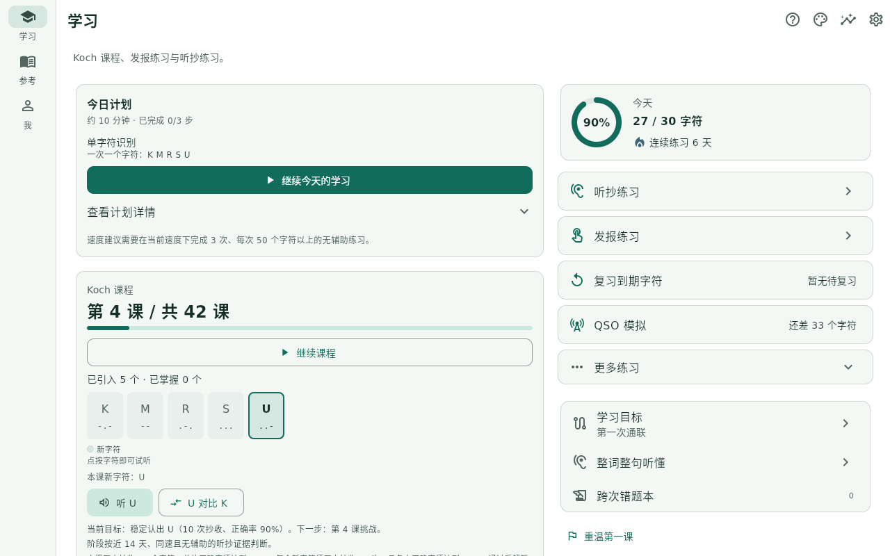

# MorseCQ

[English](README.md)

MorseCQ 是无需账号的离线莫尔斯电码训练软件，支持 Android、iOS、macOS、Linux 和 Windows。电码聊天请使用 [DitMesh](https://github.com/agentx-icu/ditmesh)。

## 安装

选择适用平台的包，按发布页中的 `SHA256SUMS` 核对校验和。签名状态与升级说明见各版本的发布说明。[GitHub 发布页](https://github.com/agentx-icu/morsecq/releases/latest)

| 平台 | 安装包 |
| --- | --- |
| Android 7.0+ | 用于设备安装的 APK |
| iOS 14+ | 开发用途的未签名 IPA。安装到设备前需签名。 |
| macOS 13+ | 支持 Apple 芯片和 Intel 的通用 PKG 或便携 ZIP |
| Linux x86_64 | DEB、RPM 或便携 tar.gz |
| Windows x64 | MSI 或便携 ZIP |

## 开始学习

1. 如果 Android 首次启动时显示隐私提示，请阅读隐私政策和使用条款，选择 **同意并继续** 进入应用。
2. 打开 **学习 → 从这里开始**，播放声音后选择 **听到了**。第一课共五步，先听辨点和划，再听示范，最后试着区分 K 和 M。[第一课截图](doc/screenshots/linux/zh/first_lesson.png)
3. 尝试一次引导练习，在总结页查看正确率和听过的字符数。准备好独立完成当前 Koch 课程时，选择 **开始本课挑战**。[抄报总结截图](doc/screenshots/linux/zh/receive_summary.png)
4. 继续尝试水平测评、间隔复习和带准备度提示的模拟通联。**参考**提供字母表、支持中文电报码的翻译器、**收听**和业余无线电工具。**我**提供训练默认值、按键配置、语言和外观设置。

手机、平板和桌面支持触摸或实体键盘训练。应用提供十种界面语言选项和四种视觉样式，也可使用学习素材、统计和录音抄报工作台辅助练习。



学习页列出今日计划中的下一项练习。点击 Koch 课程中的字符可以试听，选择 **继续课程** 可以开始练习。[截图库](doc/screenshots/README.zh-CN.md) · [产品设计](doc/designs/product-2026-10-08/README.zh-CN.md)

进阶学习提供跨次错题本、整词与整句听懂训练，以及首次通联、日常交谈和竞赛目标路线。模拟通联支持竞赛与 POTA 公园间交换、信息更正和部分重发。参考 CW Academy 进阶方向设计的原创练习全部离线运行，辅助成绩与独立掌握分开保存。见[进阶学习说明](doc/architecture/ADVANCED_LEARNING.zh-CN.md)。

完成今日计划会留下练习记录。要升入下一课，需要在独立挑战中达到各字符的掌握要求。[新手试用流程](doc/testing/BEGINNER_TRIAL.zh-CN.md)用于首日和第七日的人工观察，不增加遥测。

## 构建与运行

使用 Flutter **3.41.9** 和 Dart **3.11.5**。安装目标平台的工具后，从仓库根目录执行以下命令。在其他受支持的目标上测试时，将 `macos` 换成 `flutter devices` 列出的设备 ID。见[平台配置与打包指南](doc/operations/BUILD_AND_DEPLOY.zh-CN.md)。

```sh
flutter doctor -v
dart pub get --enforce-lockfile
flutter devices
cd apps/morsecq
flutter run -d macos
```

[商店与分发渠道矩阵](doc/release/STORE_READINESS.zh-CN.md)记录渠道状态、签名要求和设备验证情况。分支和 PR 按需生成开发包。标签发布和商店提交需要按矩阵完成对应的签名与审批。[F-Droid 准备指南](doc/release/F_DROID.zh-CN.md)记录官方收录暂缓期间的准备工作。

## 验证改动

在仓库根目录运行静态检查、包测试和组件测试。端到端测试使用连接的设备、模拟器或本机桌面。见[测试金字塔](doc/testing/TEST_PYRAMID.zh-CN.md)。

```sh
bash tool/test_pyramid.sh --level gates
bash tool/test_pyramid.sh --level unit
bash tool/test_pyramid.sh --level widget
```

## 学习数据与帮助

- 打开 **参考 → 收听 → 开始** 即可实时解码。开始时应用会请求麦克风权限。如果权限被拒绝，请在系统设置中允许后重试。音频在本机解码。
- MorseCQ 将进度、学习素材和应用管理的录音保存在设备上。在 **我 → 清除学习数据** 中确认后会删除这些内容，并保留语言、外观等偏好。清除数据或卸载前，请保存需要的素材和录音副本。系统备份行为见[隐私政策](site/zh-CN/privacy.md)。
- 在 v1.0.1 中，打开 **我 → 关于 → 技术支持与联系**。在提供离线帮助的版本中，打开 **我 → 隐私与权限 → 技术支持**。报告问题时请提供应用版本、操作系统和复现步骤。如果当前版本提供 **我 → 关于 → 复制本地诊断信息**，可选择附上复制的内容。见[支持页面](site/zh-CN/support.md)。

## 仓库结构

- `packages/morse_core`：字母表、时序、编码解码与中文电报码。
- `packages/morse_trainer`：课程、测评、间隔复习、评分与模拟通联。
- `packages/morse_dsp`：音频解码与 WAV 读取。
- `packages/radio_tools`：网格、距离、波段、CW 速度与 RST 工具。
- `packages/morse_session`：训练控制器核心、收发练习会话、记分判定与文档编解码（纯 Dart，仅 MorseCQ 使用）。
- `packages/morse_io`：音频、键控与触觉反馈。
- `apps/morsecq`：应用、本地持久化与桌面窗口服务。
- `tool`：分析、复杂度、导入、本地化与共享包门禁；CI 打包及截图采集。
- `doc`：架构、测试、构建与发布指南；`site`：公开的产品、隐私、条款与支持页面。

[文档索引](doc/README.zh-CN.md) · [学习架构](doc/architecture/OFFLINE_LEARNING.zh-CN.md) · [测试](doc/testing/TEST_PYRAMID.zh-CN.md) · [验证记录](doc/VALIDATION.zh-CN.md) · [隐私](site/zh-CN/privacy.md) · [支持](site/zh-CN/support.md) · [许可证](LICENSE)
