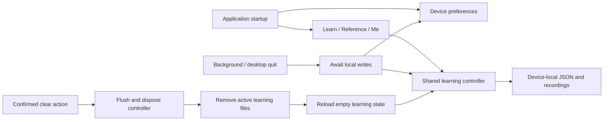

[简体中文](./OFFLINE_LEARNING.zh-CN.md)

# Offline learning architecture

The Flutter shell opens Learn directly and exposes Learn / Reference / Me on every platform. AppScope creates device-local preferences, language, key profiles, audio/reference settings and one TrainingControllerHost. No account or transport is initialized.

The host shares one controller between learning, training settings, statistics and audio workbench. Learning files are atomic JSON stores under `morsecq/guest/training/`, with previous-save fallback. Managed recordings live under `morsecq/guest/media/recordings/`. Language, appearance, decoder, reference playback, physical-key profiles and desktop window/tray preferences live in `<application support>/settings.json`, outside the learning directory.

Lifecycle transitions flush learning and preferences. Desktop quit awaits the same barrier, and iOS uses a short native background task for local writes; leaving again while a save is running schedules one more barrier before that task ends. Clearing learning data suspends access, waits for pending writes (an earlier failed save does not block it), retires the old controller, removes only the active training/recording directories, and notifies the learning UI to open a new empty controller. App-wide preferences remain available.

## Learning path and evidence

A fresh local profile opens the first lesson: hear dit/dah, hear K/M, watch a worked example and complete six assisted recognition trials. It records `firstLessonDoneAt`, then offers graded guided recognition and model-led sending. Recognition pace and guided-send stages persist in current learning files.

Learner stage, per-symbol mastery, daily-plan focus and QSO readiness use recent independent evidence. Assisted trials, revealed answers and free practice cannot unlock lessons. A Koch challenge requires at least 50 copied characters at 90% overall accuracy, plus ten attempts at 90% for each newly introduced symbol. Reaching lesson 42 does not complete the course: passing its challenge sets `courseCompleted`. Practice summaries preserve this distinction and suggest the next useful action.

`FileTrainerStore` saves both progress fields atomically and falls back to the previous valid save if they are malformed. The same account-free `LocalLearningStore` is injected into the native first-day test and the screenshot harness. Real write/reopen coverage is in the [persistence audit](../testing/PERSISTENCE_AUDIT.md) and the [test pyramid](../testing/TEST_PYRAMID.md); mistakes, comprehension records and goals are described in [advanced learning](ADVANCED_LEARNING.md).

## Backup storage layer

`lib/training/backup/` holds the storage layer for a portable learning backup; no Me-page action uses it yet. A backup is a versioned `*.morsecq-backup.json` envelope with a canonical SHA-256, size and document-count limits, and per-document validation shared with the runtime loaders. A snapshot reads each document through `AtomicJsonFile` with its previous-save fallback and reports unusable or unknown documents instead of dropping them. A restore replaces `training/` with a staged two-rename swap that rolls back on failure and keeps a previous directory it could not move back for a later recovery step. `LearningRootLock` provides a shared/exclusive profile lock, but the replacement does not take it itself: the future restore caller must hold the exclusive lock and run recovery before the learning controller opens.

Recordings are not part of a backup. A restore lists every recording present in `media/recordings_kept.json`, which lives outside `training/`, so the workbench sweep of unreferenced recordings keeps them. Clearing learning data removes restore leftovers first, so a later recovery cannot bring a cleared profile back.
