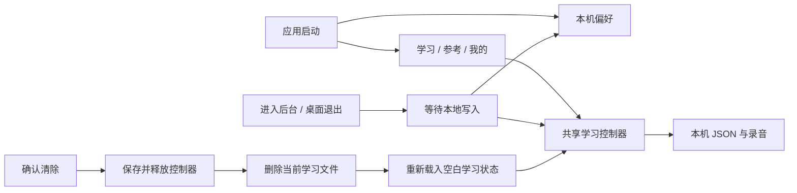

[English](./OFFLINE_LEARNING.md)

# 本地学习架构

应用直接打开学习，所有平台只有学习 / 参考 / 我的三个导航目标。AppScope 创建本机偏好、语言、实体键配置、音频与参考设置，以及共享 TrainingControllerHost。启动不创建账号或聊天传输服务。

控制器由学习、训练设置、统计和音频工作台共享。本地学习文件通过原子 JSON 替换保存在 `morsecq/guest/training/`，损坏时读取前一次有效保存；托管录音位于 `morsecq/guest/media/recordings/`。语言、外观、解码器、参考播放、实体键配置与桌面窗口 / 托盘偏好位于学习目录之外的 `<应用支持目录>/settings.json`。

生命周期暂停与桌面退出等待学习和偏好写入；iOS 使用短时原生后台任务完成本地保存；保存进行中再次离开前台时，会在该任务结束前再执行一次保存屏障。确认清除时暂停访问，等待待保存数据写完（此前某次保存失败不会阻止清除），释放旧控制器，删除当前训练和录音目录，再通知界面重新打开空白控制器。应用语言、外观与桌面偏好继续保留。

## 教学路径与证据

新建本地学习状态首先提供点划与 K/M 听辨、完整示例及六次辅助识别。完成后保存 `firstLessonDoneAt`，再进入分级引导识别和示范发报；识别节奏与引导发报阶段保存在当前学习文件中。

学习阶段、逐字符掌握、每日计划重点和模拟通联准备度使用近期独立练习证据。辅助识别、显示答案和自由练习不解锁课程。科赫挑战要求至少抄写 50 个字符，总体准确率达到 90%，每个新引入字符至少尝试十次且准确率达到 90%。到达第 42 课不等于完成课程，必须通过该课挑战才设置 `courseCompleted`。练习总结明确区分这些状态并提供下一步。

`FileTrainerStore` 原子保存这两个进度字段；值格式错误时退回前一次有效保存。原生首日测试与截图流程都注入无需账号的 `LocalLearningStore`。真实写入和重开验证见[持久化审计](../testing/PERSISTENCE_AUDIT.zh-CN.md)与[测试说明](../testing/TEST_PYRAMID.zh-CN.md)；错题、听懂记录与目标见[进阶学习](ADVANCED_LEARNING.zh-CN.md)。

## 备份存储层

`lib/training/backup/` 是可移植学习备份的存储层，目前「我的」页面尚未提供对应操作。备份是带版本号的 `*.morsecq-backup.json` 封装，包含规范化 SHA-256、大小与文档数量上限，并与运行时加载器共用逐文档校验。快照通过 `AtomicJsonFile` 读取每个文档并使用上一次有效保存兜底，无法使用或未知的文档会被报告而不是静默丢弃。恢复以分阶段的两次重命名替换 `training/`：失败时回滚；旧目录无法移回时保留在旁边，留待后续恢复步骤处理。`LearningRootLock` 提供共享 / 独占档案锁，但替换本身不会获取它：今后的恢复调用方必须持有独占锁，并在学习控制器打开之前执行恢复。

录音不进入备份。恢复会把当时设备上的全部录音记入位于 `training/` 之外的 `media/recordings_kept.json`，工作台清理未引用录音时会保留它们。清除学习数据会先删除恢复遗留文件，避免后续恢复把已清除的档案带回来。
